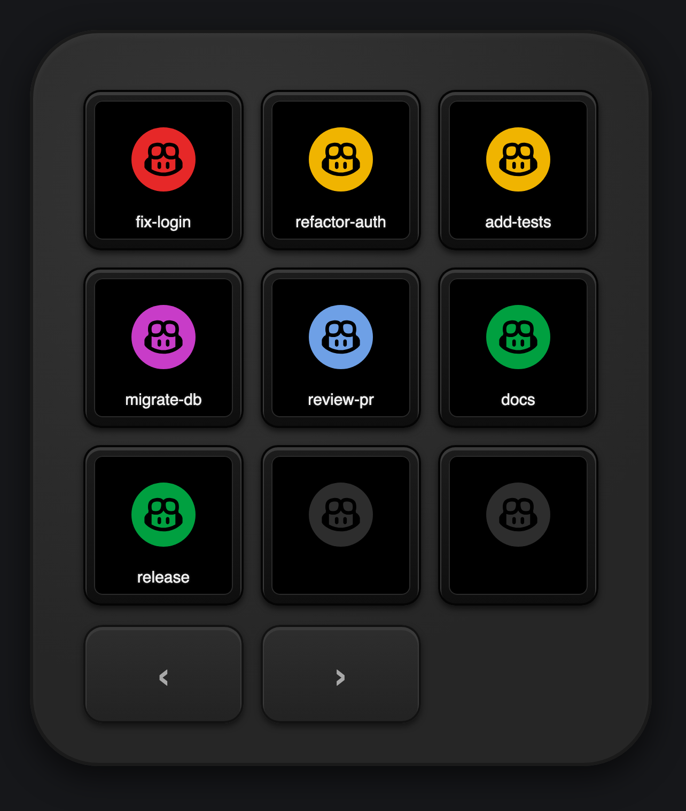
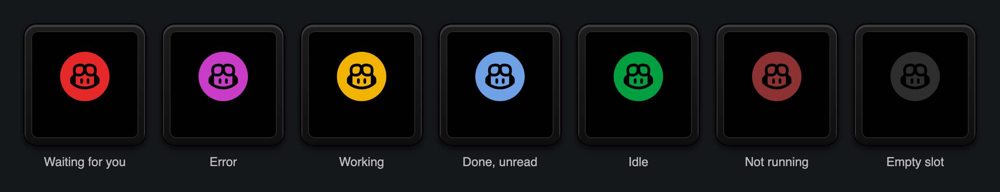
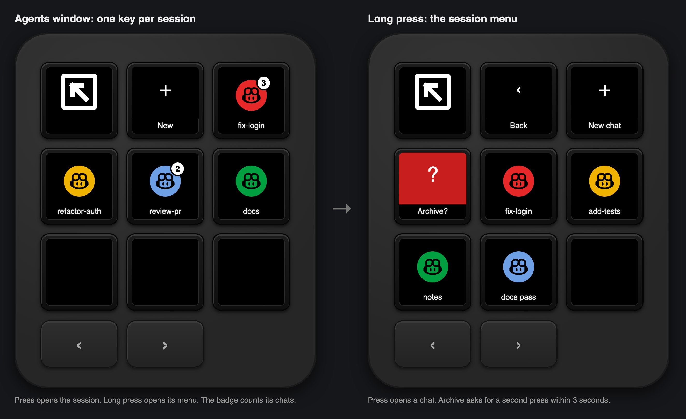
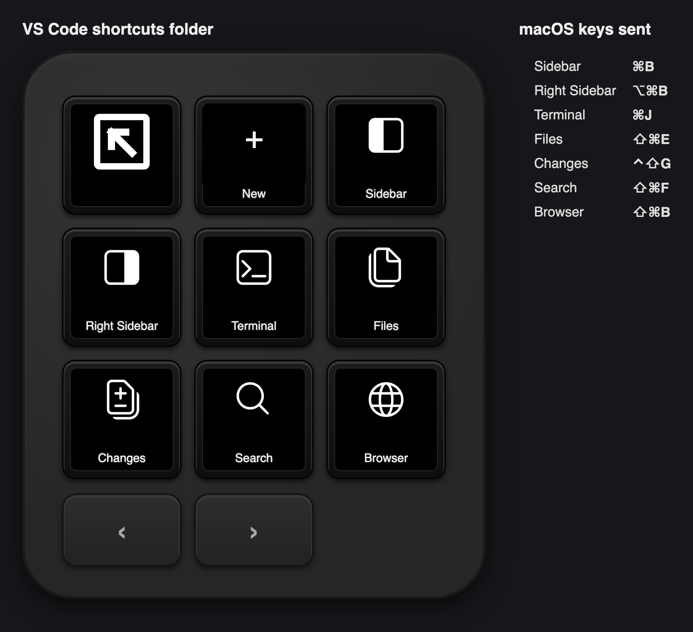

# VS Code Agents window Logi plugin

Live status of your VS Code Agents window sessions (GitHub Copilot) on the Logitech MX Creative Keypad. Press a key to jump to one. A Logi Options+ plugin built on the Logi Actions SDK, with keys for new sessions and the Agents window's layout shortcuts.

Status: 0.1.0, first working version. Tested on macOS. Windows support is written but untested.

<p align="center">
  
</p>

> The images are diagrams drawn from the plugin's own colors and icons, not photos.

## Install

Requires macOS, VS Code 1.144 or later, Logi Options+ with Logi Plugin Service 6.4 or later, and an MX Creative Keypad (or Loupedeck CT).

1. Download `AgentsWindow_<version>.lplug4` from the [latest release](https://github.com/robertohuertasm/vscode-agents-window-logi-plugin/releases/latest).
2. Double-click it. Logi Options+ installs the plugin.
3. In Options+, select the Keypad, open **All actions**, and drag the actions below onto keys.

## Actions

Drag these onto keys in Logi Options+ (group **VS Code Agents Window**):

| Action | What it does |
|---|---|
| **Recent chat 1…9** | The Nth chat across all non-archived sessions, so a session with several active chats takes several keys: waiting for input first, then error, unread, working, then idle, in session order. Press opens that chat. A long press asks **Archive?** and a press within 3 seconds archives it; the main chat archives its whole session. Keys placed as "Recent session" in 0.1.0 keep working. |
| **New session** | Opens the Agents window on the new-session composer. While VS Code is not running the key reads **Start VS Code** (▶); the same press starts it. |
| **Agents window** (folder) | Opens a folder with the system back key, **New**, and one key per session. A press opens a session. A long press opens the session's menu: **Back**, **New chat** (creates a chat in that session and opens it), **Archive** (the whole session), and one key per chat. In the menu, a press opens a chat and a long press archives it. VS Code refuses to archive side chats (started from another chat) and the main chat on their own, so a long press just opens those. Archiving asks for a second press within 3 seconds (the key turns red with "Archive?"). Sessions with several chats show a white badge with the count. |
| **Sidebar, Right Sidebar, Terminal, Files, Changes, Search, Browser** (group **Shortcuts**) | Send the Agents window's keybinding for that view. macOS: ⌘B, ⌥⌘B, ⌘J, ⇧⌘E, ⌃⇧G, ⇧⌘F, ⇧⌘B. Windows: Ctrl+B, Ctrl+Alt+B, Ctrl+J, Ctrl+Shift+E, Ctrl+Shift+G, Ctrl+Shift+F, Ctrl+Shift+B. VS Code is brought to the front first; the keys are only sent once it is frontmost. The key shows VS Code's icon for the view (codicon) and its name; the description in Options+ gives the shortcut for the current platform. |
| **VS Code shortcuts** (folder, group **Shortcuts**) | Opens a folder with the system back key, **New** (as the New session key), and the seven shortcut keys above: one Keypad page with everything. |

Session and chat keys show a black Copilot face (codicon) on a disc colored by state: red waiting for input, purple error, amber working, blue finished but not looked at yet (VS Code's blue dot), green idle, dark red VS Code not reachable, dark grey for an empty slot. A chat stopped on a resumable error (VS Code's blue Keep Going or Try Again button) shows purple too, even when VS Code reports it as idle. A session key shows its most urgent chat, so a side chat waiting or unread colors the whole session.







## How it works

- **State:** VS Code's local Agent Host publishes an [Agent Host Protocol](https://microsoft.github.io/agent-host-protocol/) endpoint for other local processes. The plugin finds it through `agent-host/local-endpoint/entries/*.json` in VS Code's user data directory (`~/Library/Application Support/Code` on macOS, `%APPDATA%\Code` on Windows), connects over the Unix socket (macOS) or named pipe (Windows) with the entry's token, and polls `listSessions` once a second. The token is never logged.
- **Actions:** archiving dispatches `session/isArchivedChanged` or `chat/isArchivedChanged`, and New chat sends `createChat`, each after subscribing to the target channel (the host only acts on loaded channels).
- **Shortcuts:** `open -b com.microsoft.VSCode` brings VS Code forward, `lsappinfo` confirms it is frontmost, then the Plugin Service's `KeyboardApi.SendShortcut` presses the keys. They act on whichever VS Code window was focused last.
- **Focus:** a press opens `vscode://agents/agent-host-session/<provider>/<sessionId>[/chat/<chatId>]`, which VS Code routes to the Agents window. New session uses `vscode://agents/new?prompt=`.
- **Client:** the official .NET client, [`Microsoft.VisualStudioCode.AgentHostProtocol`](https://www.nuget.org/packages/Microsoft.VisualStudioCode.AgentHostProtocol).

The plugin layout follows [niklasberglund/herdr-logi-plugin](https://github.com/niklasberglund/herdr-logi-plugin).

## Layout

- `src/AgentsWindow.Core`: everything that does not need the Logi API (endpoint discovery, AHP client, parsing, ranking, links). Tested directly.
- `src/AgentsWindowPlugin`: the Logi plugin (actions, folder, key faces).
- `tests/AgentsWindow.Core.Tests`: xUnit tests for the core.
- `package/metadata/LoupedeckPackage.yaml`: plugin manifest and the only version number.
- `src/AgentsWindowPlugin/Icons`: [codicons](https://github.com/microsoft/vscode-codicons) (CC BY 4.0) for the shortcut keys.
- `probes/`: throwaway research probes.

## Windows (untested)

The code handles Windows paths, VS Code's named pipe endpoint, and opening links through the shell, but nobody has run it there yet. To try it: install the .NET 10 SDK, Logi Options+, and VS Code 1.144 or later, then run `dotnet build src/AgentsWindowPlugin` and check the log. Please report what works.

## Development

Requires the .NET 10 SDK, Logi Options+ with Logi Plugin Service 6.4 or later, and VS Code 1.144 or later.

```sh
dotnet test tests/AgentsWindow.Core.Tests
dotnet build src/AgentsWindowPlugin       # Debug: links build/Debug into the Plugin Service and reloads it
dotnet clean src/AgentsWindowPlugin       # removes the link
```

The log is at `~/Library/Application Support/Logi/LogiPluginService/Logs/plugin_logs/AgentsWindow.log` on macOS and `%LOCALAPPDATA%\Logi\LogiPluginService\Logs\plugin_logs\AgentsWindow.log` on Windows. A warning that the service "Cannot create dynamic action" for `RecentChatCommand` is expected: the plugin adds those actions itself.

## Release

Set `version` in `package/metadata/LoupedeckPackage.yaml`, commit, and push a matching tag (`git tag v0.1.0 && git push origin v0.1.0`). The release workflow runs the tests, builds Release, packs and verifies `AgentsWindow_<version>.lplug4` with `LogiPluginTool`, and attaches it to a GitHub Release. To pack locally: `dotnet build src/AgentsWindowPlugin -c Release`, then `logiplugintool pack build/Release AgentsWindow_<version>.lplug4`. Remove a dev link with `dotnet clean src/AgentsWindowPlugin` before installing the package.

## Probes

- [`probes/AhpProbe`](probes/AhpProbe): connects to the live Agent Host endpoint read-only and prints aggregate counts by provider and status.
- [`probes/AhpLoadProbe`](probes/AhpLoadProbe): a throwaway Logi plugin with no actions that proves the client works inside Logi Plugin Service.

```sh
dotnet run --project probes/AhpProbe
dotnet build probes/AhpLoadProbe -p:Link=true
rm ~/Library/Application\ Support/Logi/LogiPluginService/Plugins/AhpLoadProbe.link
```

## License

MIT. See [LICENSE](LICENSE). Codicons are CC BY 4.0.
